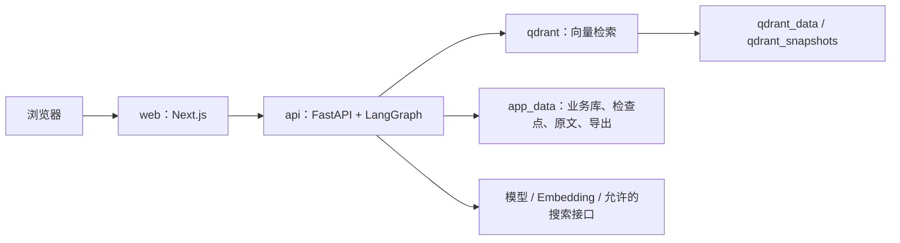
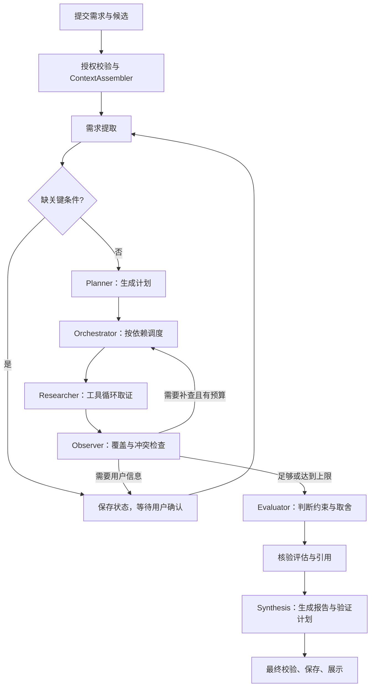

# 企业知识库检索方案选型 Agent：五层架构与从零开发指南

版本：v1.0  
日期：2026-10-12  
建议项目名：enterprise-retrieval-advisor  
开发周期：8 周，单人开发；主要开发日每天约 4–6 小时。

本文是后续开发的执行文档：结合 DevFlow 公开介绍中的五层架构与协作职责、当前 GPT Researcher 仓库代码，以及企业知识库检索方案选型场景。每个步骤包含实现内容、建议文件、输入输出、参考位置和验收要求。当前交付为设计文档，步骤中的代码、接口和容器均是待实现内容。

## 目录

1. 项目目标与业务边界
2. 五层架构、技术栈与 Docker 部署
3. 协作角色与请求执行流程
4. GPT Researcher 代码参考地图
5. 项目目录与数据契约
6. 从零实现的 30 个步骤
7. 八周逐日开发安排
8. 数据库、接口与事件协议
9. 测试、评测与最终交付
10. 开发规则、延期顺序与参考资料

## 1. 项目目标与业务边界

### 1.1 要解决的问题

研发人员为企业知识库选择检索方案时，需要阅读现有架构、部署要求、文档规模和更新方式，再查候选方案的官方资料，确认权限过滤、更新接口、运维条件等能力。资料分散、版本不同、证据不足时，容易给出缺少依据的建议。

本项目将这些工作组织为：理解需求 → 明确约束 → 制定研究计划 → 调用工具取证 → 检查缺口 → 有限补查 → 比较候选 → 核验 → 输出建议及验证计划。

### 1.2 标准演示任务

用户上传企业架构文档、知识库需求说明，指定 2–3 个候选方案，并提出：

> 请为我们的中文企业知识库选择检索方案。必须支持指定的私有部署与项目权限要求，需要支持文档增量更新。请根据提供的材料比较候选方案，给出依据、未确认事项和验证计划。

最终输出：

- 用户需求、硬性约束、软性偏好和已确认假设。
- 候选方案与评价维度组成的比较矩阵。
- 每项判断的证据、适用版本和限制条件。
- 推荐方案、可选替代方案以及选择理由。
- 无法确认或存在冲突的事项。
- 性能、容量和成本的验证计划；有明确数据时给出带假设的估算。

### 1.3 第一版范围

| 必须完成 | 后续扩展 |
|---|---|
| 文本型 PDF、Markdown、TXT；项目成员权限；有效文档版本 | 扫描件 OCR、复杂表格、组织 SSO |
| 用户指定 2–3 个候选；内部与可选联网研究 | 自动发现候选、持续监测产品变化 |
| 工具循环、规划、缺口检查、有限补查 | 不受限的自主研究、通用插件框架 |
| 候选研究任务分工、受限并行、统一汇总 | 多层嵌套 Agent、跨服务 Agent 平台 |
| 引用定位、约束核验、人工反馈、报告版本 | 自动部署候选系统、自动执行完整性能实验 |
| 持久化任务、事件、检查点、手动恢复 | 分布式调度、高可用、多 API 实例 |

只使用公开或合成材料完成演示。企业真实材料能否发往模型提供方属于部署配置边界，需要明确允许的数据范围。

### 1.4 业务判断规则

1. 先检查硬性约束，再比较软性偏好。已确认违反硬性约束的候选不能被其他高分掩盖。
2. 判断结果必须区分：满足、不满足、无法确认、证据冲突。
3. 未找到资料不意味着候选不支持。工具调用失败也不意味着候选不支持。
4. 版本、部署模式和适用条件必须进入证据与判断记录。
5. 综合分只在用户确认权重与评分规则后产生；分数不表示可信概率。
6. 性能描述、费用估算和真实实验结果分别标记。没有实测时输出验证计划。
7. 用户修改条件后形成新的需求修订和报告版本，旧结论不被悄悄覆盖。
8. 达到补查、核验或预算上限时保留未知与冲突，输出受限结果或等待人工输入。

助手采用 Qdrant 作为自己的证据检索组件，不预设它会被推荐为用户的最终方案。

## 2. 五层架构、技术栈与 Docker 部署

### 2.1 五层职责

| 层 | 本项目模块 | 主要职责 | 技术 |
|---|---|---|---|
| 用户层 | 项目、文档、任务、报告、证据页面 | 收集条件、查看过程、回复澄清、复核结果 | Next.js、React、TypeScript |
| 应用服务层 | API、会话、授权、任务服务、上下文入口、事件流 | 校验请求、限定项目范围、创建运行、推送进度 | FastAPI、Pydantic、SQLAlchemy、SSE |
| 智能协作层 | Planner、Orchestrator、Researcher、Observer、Evaluator、Synthesis | 规划、调度、取证、检查缺口、比较、汇总 | LangGraph、Tool Calling、结构化输出 |
| 知识与工具层 | 文档入库、检索、网页读取、估算、项目记忆 | 提供有效资料和可验证工具结果 | PyMuPDF、Embedding、BM25、RRF、HTTP 客户端 |
| 数据基础层 | 业务库、证据库、向量索引、检查点、文件卷 | 持久化、版本一致性、任务轨迹、备份 | SQLite、Qdrant、Docker 命名卷 |

ContextAssembler 位于应用服务与智能协作的边界：它把授权后的业务事实组织为模型输入，不拥有无限检索或调度权限。

DevFlow 的五层划分和角色名称来自公开架构介绍；本项目中的契约、流程、文件和实现顺序是针对选型场景的设计。没有读取 DevFlow 的付费源码，不假定其内部实现细节。

### 2.2 技术决策

| 技术 | 首版使用方式 | 加入时间 |
|---|---|---|
| Python | 与参考仓库一致，采用兼容的 3.12 系列 | 第 1 周 |
| FastAPI、Pydantic | 接口、输入输出契约、参数校验 | 第 1 周 |
| SQLAlchemy、SQLite | 单实例的项目、文档、任务和报告 | 第 1 周 |
| LangGraph | Typed State、节点、条件路由、检查点 | 第 4 周完整接入；第 1 周验证兼容性 |
| 模型适配器 | 一个支持工具调用和结构化输出的提供方 | 第 1 周验证，第 3 周用于基础生成 |
| LangChain 相关组件 | 按所选模型使用必要的消息、工具或模型适配包 | 按实际接入需要 |
| PyMuPDF | 文本型 PDF 解析；MD/TXT 使用普通文本处理 | 第 2 周 |
| Embedding、Qdrant | 单一向量空间、持久化索引、元数据过滤 | 第 2–3 周 |
| 中文分词、BM25、RRF | 与向量召回融合；先采用已有可靠库或简明实现 | 第 3 周 |
| 专门 Reranker | 评测证明需要后增加 | 扩展，不阻塞首版 |
| Next.js、React、TypeScript | 与参考项目的前端语言一致，分阶段接页面 | 第 1–5 周 |
| SSE | 单向推送事件；先有轮询接口，再增加流式展示 | 第 6 周 |
| pytest、pytest-asyncio | 关键逻辑与异步执行回归 | 随开发持续加入 |
| Ragas | 可选辅助语义评测，结合人工抽查 | 第 7 周有余量时加入 |
| MCP、Skill Runtime | 有明确外部服务或流程复用需求后加入 | 扩展 |
| Docker Compose | 开发、集成测试与演示部署 | 第 1 周 |

PostgreSQL、Milvus 不作为首版必需组件。未来多实例调度需要重新设计持久化与任务租约，届时可迁移数据库。

### 2.3 Docker 服务



| 服务 | 容器内通信 | 对外访问 | 存储 |
|---|---|---|---|
| web | 上游 http://api:8000 | 开发机 localhost:3000 | 构建产物 |
| api | http://qdrant:6333 | 开发调试可绑定 127.0.0.1:8000 | app_data 命名卷 |
| qdrant | Compose 内网 | 需要控制台时才绑定 127.0.0.1:6333 | qdrant_data、qdrant_snapshots 命名卷 |

- 浏览器使用同源 /api 路径，不能把容器服务名直接写成浏览器地址。Next.js 转发需保留会话、错误码与流式响应。
- 业务库 app.db 与检查点 checkpoints.db 分文件；SQLite 不额外开容器。
- Windows 下用 Docker 命名卷保存数据库、向量和原文；开发源码可用 compose.dev.yaml 单独挂载。
- API 固定一个 Uvicorn worker，避免进程内队列和 SQLite 调度产生多实例歧义。
- /health/live 检查进程；/health/ready 检查必要数据服务。健康检查不调用付费模型。
- Compose 配置健康检查和启动依赖，API 仍处理临时依赖失败。健康检查命令需确实存在于所选镜像。
- 密钥只注入后端，.env.example 使用占位值；前端公开环境变量和镜像中不含密钥。
- 依赖与镜像在首周选定兼容版本并锁定，提交锁文件。开发热更新与演示构建分开。
- 命名卷不是备份。交付时验证 SQLite 一致性备份、原文与 Qdrant 快照的恢复流程。

## 3. 协作角色与请求执行流程

### 3.1 每个角色做什么

| 模块 | 输入 | 输出 | 由程序保证的边界 |
|---|---|---|---|
| ContextAssembler | 用户请求、项目授权、有效文档、已确认偏好 | ContextBundle | 权限、有效版本、Token 预算、来源标识 |
| Planner | ContextBundle、结构化需求、候选 | ResearchPlan | 有效任务 ID、合法维度、无循环依赖、计划规模上限 |
| Orchestrator | 计划、任务结果、剩余预算 | 调度决定、任务状态 | 依赖、并发、失败跳过、取消、执行上限 |
| Researcher | 单个候选/维度子任务、工具结果 | ResearchTaskResult、Evidence | 只允许登记工具，参数、来源和预算校验 |
| Observer | 计划、结果、覆盖矩阵、冲突 | Observation、有限补查建议 | 合法路由、共享补查次数、记录未解决事项 |
| Evaluator | 用户约束、候选事实、证据 | CandidateAssessment | 硬约束优先、未知状态、数据与单位校验 |
| Synthesis | 通过核验的评估、证据、剩余未知项 | SelectionReport | 引用完整性、报告版本、来源与限制保留 |

角色是职责边界，初期用节点函数实现。Researcher 内部有真实模型工具决策循环；Orchestrator 的依赖与并发调度主要由确定代码完成。单纯更换角色 Prompt 不自动形成多 Agent 协作。

后续候选 Worker 各自接收不可混淆的任务输入与独立消息状态，共享经授权的只读需求快照，在 Orchestrator 控制下并行。Planner 不可创建任意可执行代码或注册未授权工具。

### 3.2 全链路



### 3.3 Agent 的真实决策与程序控制

模型决定：如何分解、查询如何表达、下一步查什么、证据表达了什么、如何解释取舍。

程序决定：谁有权限、能调哪些工具、参数是否合法、任务能否启动、剩余额度、数值计算、状态转换和引用是否存在。

所有循环共享预算：初期最多两轮补查，另设工具总调用数、模型输入预算、任务超时和估算费用上限。人工确认可暂停，不因次数达到上限而自动视为用户批准。

## 4. GPT Researcher 代码参考地图

以下链接指向当前本地参考仓库。新项目移动后，可按表中的仓库相对路径在参考源码中定位。

| 阅读顺序 | 本地参考位置 | 学习重点 | 你要写的模块 |
|---|---|---|---|
| 1 | [backend/server/app.py](F:/AgentProject/gpt-researcher/backend/server/app.py:53) | 请求模型、接口和入口 | schemas/request.py、api/runs.py |
| 2 | [backend/report_type/basic_report/basic_report.py](F:/AgentProject/gpt-researcher/backend/report_type/basic_report/basic_report.py) | conduct_research → write_report 的边界 | agent/service.py |
| 3 | [gpt_researcher/agent.py](F:/AgentProject/gpt-researcher/gpt_researcher/agent.py:343) | 研究、上下文、成本与报告的组织 | agent/state.py、runtime/budget.py |
| 4 | [gpt_researcher/actions/query_processing.py](F:/AgentProject/gpt-researcher/gpt_researcher/actions/query_processing.py:158) | 子问题规划与结构化输出处理 | agent/planner.py |
| 5 | [gpt_researcher/skills/researcher.py](F:/AgentProject/gpt-researcher/gpt_researcher/skills/researcher.py:68) | 来源分流、子任务研究、查询与证据获取 | agent/researcher.py、tools/ |
| 6 | [gpt_researcher/document/document.py](F:/AgentProject/gpt-researcher/gpt_researcher/document/document.py) | 文档加载与格式路由 | ingestion/parser.py、chunker.py |
| 7 | [gpt_researcher/vector_store/vector_store.py](F:/AgentProject/gpt-researcher/gpt_researcher/vector_store/vector_store.py) | 切分、向量库封装与检索过滤 | retrieval/vector.py |
| 8 | [gpt_researcher/context/select.py](F:/AgentProject/gpt-researcher/gpt_researcher/context/select.py:53) 与 [context_manager.py](F:/AgentProject/gpt-researcher/gpt_researcher/skills/context_manager.py:38) | 上下文筛选、预算、降级 | retrieval/context.py、agent/context_assembler.py |
| 9 | [gpt_researcher/skills/writer.py](F:/AgentProject/gpt-researcher/gpt_researcher/skills/writer.py:49) | 基于上下文生成报告 | agent/synthesis.py |
| 10 | [multi_agents/agents/orchestrator.py](F:/AgentProject/gpt-researcher/multi_agents/agents/orchestrator.py:65) | 图节点、条件边、人工与核验循环 | agent/graph.py、orchestrator.py |
| 11 | [multi_agents/agents/editor.py](F:/AgentProject/gpt-researcher/multi_agents/agents/editor.py:57) | 并行研究的组织与结果汇总 | agent/parallel.py |
| 12 | [multi_agents/agents/fact_checker.py](F:/AgentProject/gpt-researcher/multi_agents/agents/fact_checker.py:10) | 审查结果驱动修订 | assessment/verifier.py、agent/observer.py |
| 13 | [backend/server/report_store.py](F:/AgentProject/gpt-researcher/backend/server/report_store.py:7) 与 [websocket_manager.py](F:/AgentProject/gpt-researcher/backend/server/websocket_manager.py) | 报告保存、执行与消息传输 | db/、runtime/、api/events.py |
| 14 | [evals/README.md](F:/AgentProject/gpt-researcher/evals/README.md) | 准确性、质量、幻觉与成本评测 | 自己的 evals/ 与 tests/ |

### 4.1 仿写时要做的适配

- 自己实现选型业务，不以 import GPTResearcher 代替研究核心。
- 普通研究中的自动角色选择主要产生角色提示；本项目先固定选型职责，不必引入动态人格选择。
- 当前文档加载输出主要保留正文与文件名。自己的加载器要传递项目、版本、页码/文本位置和内容哈希。
- 当前向量封装保留的元数据较少。自己的片段模型不能只保存 source。
- gpt_researcher/memory/embeddings.py 的 Memory 主要管理 Embedding 提供方，不能据此认为已有完整长期记忆。
- 参考仓库多 Agent 的部分审查路由会在修订次数达到上限后进入后续流程。自己的实现必须保留未解决项，人工批准不能被次数上限替代。
- 原项目的 ResearchAgent 会内部调用 GPTResearcher。参考其职责分工，新的 Researcher 自己实现工具循环与证据返回。
- 参考报告存储的职责，新的业务持久化使用数据库；当前 WebSocket 传输思路适配为任务事件与 SSE。

阅读每个参考模块时记录：输入、返回值、状态修改、外部调用、错误处理、与你业务不相符的部分。每次仿写一个可验证功能。

## 5. 项目目录与数据契约

### 5.1 建议目录

```text
enterprise-retrieval-advisor/
├── compose.yaml
├── compose.dev.yaml
├── .env.example
├── README.md
├── backend/
│   ├── Dockerfile
│   ├── pyproject.toml
│   ├── app/
│   │   ├── main.py
│   │   ├── config.py
│   │   ├── api/          # auth、projects、documents、runs、reports、events
│   │   ├── schemas/      # request、requirement、plan、evidence、assessment、report
│   │   ├── db/           # 连接、表模型、schema 变更脚本
│   │   ├── ingestion/    # parser、chunker、indexer、versions
│   │   ├── retrieval/    # vector、lexical、fusion、context
│   │   ├── tools/        # internal_search、evidence_read、public_search、fetch、estimate
│   │   ├── agent/        # context_assembler、planner、researcher、observer
│   │   │                 # orchestrator、graph、state、synthesis、parallel
│   │   ├── assessment/   # evaluator、verifier、rules
│   │   └── runtime/      # queue、events、budget、cancellation、recovery
│   └── tests/
├── frontend/
│   ├── Dockerfile
│   ├── package.json
│   ├── package-lock.json
│   ├── app/
│   ├── components/
│   └── lib/
├── evals/
│   ├── cases.jsonl
│   ├── run.py
│   ├── metrics.py
│   └── results/
└── docs/
```

目录按步骤增加，不一次生成空架构。backend/app 作为包使用明确导入；避免修改 sys.path 造成多个包名并存。真实版本和依赖由锁文件确定。

### 5.2 核心契约

| 契约 | 最小字段 | 校验要点 |
|---|---|---|
| SelectionRequest | goal、candidates、hard_constraints、preferences、allow_web_search | 目标非空、2–3 个候选、文本与列表上限 |
| CandidateInput | name、version_label、edition/deployment_mode、official_domains | 产品版本可未知，不强制所有厂商遵循 SemVer |
| Requirement | 约束 ID、类型、描述、来源、未知项、已确认假设 | 不自行确认用户未提供的条件 |
| ContextBundle | 有权限的需求、文档版本、候选、确认记忆、来源摘要 | project_id/user_id 来自服务端执行上下文 |
| ResearchTask | task_id、candidate_id、dimension、query、depends_on、completion_criteria | 依赖存在、无环、规模受限 |
| ResearchPlan | plan_revision、tasks | 版本化并可验证 |
| Evidence | evidence_id、source_type、text、version/position、URL/time、product_scope | 引用真实可读，位置和适用范围明确 |
| ResearchTaskResult | task_id、status、facts、evidence_ids、gaps、tool_errors | failed/partial 与产品不支持分开 |
| Observation | coverage、conflicts、gaps、next_action、follow_up_tasks | 路由为枚举，补查受共享预算控制 |
| CandidateAssessment | candidate_id、constraint_id、verdict、reason、evidence_ids、conditions | satisfied/unsatisfied/unknown/conflicting |
| SelectionReport | revision、requirements、matrix、recommendation、unknowns、validation_plan | 报告结论与评估、引用一致 |

请求示例，产品名称仅为演示占位：

```json
{
  "goal": "为企业中文知识库选择检索方案",
  "candidates": [
    {"name": "方案A", "version_label": null},
    {"name": "方案B", "version_label": null}
  ],
  "hard_constraints": ["满足指定的私有部署要求", "满足项目权限过滤要求"],
  "preferences": ["维护成本低", "文档更新方便"],
  "allow_web_search": false
}
```

字段填写错误由 API 返回校验错误；语义上缺少规模、预算、权限具体定义等条件，由需求提取与人工澄清处理。

### 5.3 Agent 状态与业务状态

图状态保存：run_id、attempt_id、requirement_revision、plan_revision、需求、候选、任务状态、结果 ID、证据 ID、gaps、iteration、budget、等待输入项、report_id。大段原文放证据库，状态中保留 ID 和必要摘要。

业务运行状态：queued、running、waiting_user、completed、failed、cancelled、interrupted。

completed 可附 complete/partial 的结果完整性；程序失败为 failed。达到研究预算且有受限报告时可以 completed + partial，必须展示未解决项。

## 6. 从零实现的 30 个步骤

执行顺序是依赖顺序。第 1–5 步建立工程边界，第 6–15 步建立证据链，第 16–24 步实现研究闭环，第 25–28 步完善协作与运行，第 29–30 步验证和交付。

### 步骤 01：确定场景、准备材料、阅读入口

- 实现：在独立项目目录初始化自己的仓库，写 README 的问题、用户、第一版范围、最终输出和验收规则。准备约 10–20 份公开/合成文档、首批 10 个问题。
- 文件：README.md、docs/scope.md、演示数据初始化说明。
- 输入输出：业务说明 → 固定场景、数据清单、阅读笔记；此时没有研究代码。
- 参考：参考地图 1–3；画出请求 → 研究 → 报告调用链。
- 验收：能够说明硬约束、未知项和引用要求；明确内部材料与公开材料的边界。

### 步骤 02：Docker 骨架与健康检查

- 实现：后端 FastAPI、前端最小页面、Qdrant 三服务；开发与演示配置分离；命名卷、网络、依赖锁和健康检查。
- 文件：compose.yaml、compose.dev.yaml、backend/Dockerfile、frontend/Dockerfile、app/main.py、config.py。
- 输入输出：配置 → 可启动容器、/health/live 与 /health/ready、前端页面。
- 参考：当前仓库 Compose 的构建、端口与卷思路；具体配置自己编写。
- 验收：从干净环境启动；浏览器与容器地址正确；数据库/索引卷持久化；密钥不暴露。

### 步骤 03：选型请求与结构化契约

- 实现：SelectionRequest、CandidateInput、枚举和字段限制；POST /api/requirements/validate 只校验并返回输入，不声称已研究。
- 文件：schemas/request.py、api/requirements.py；其余契约随后续步骤增加。
- 输入输出：JSON 请求 → 校验后的输入或 422。
- 参考：backend/server/app.py 的 ResearchRequest。
- 验收：合法输入通过，空目标、错误类型、无效候选数量被拒绝；保留一个有意义的契约测试。

### 步骤 04：最小模型接入与能力验证

- 实现：一个模型提供方的适配器、环境配置、异步调用、超时、结构化输出、usage 记录；验证一次工具调用。
- 文件：app/model.py、config.py、schemas/requirement.py、模型集成检查说明。
- 输入输出：用户说明 → 经校验的约束与未知项；模型工具请求 → 可解析的工具名和参数。
- 参考：gpt_researcher/utils/llm.py 的调用与成本职责，query_processing.py 的结构化处理。
- 验收：真实 API 能力确认；缺密钥明确显示未配置；测试可用标注的模拟模型；无效输出有限重试后显式失败。

### 步骤 05：数据库、会话与项目权限

- 实现：users、sessions、projects、project_members；预置账号登录退出；项目创建、列表；统一服务层授权。
- 文件：db/models.py、db/session.py、api/auth.py、api/projects.py；前端登录与项目页。
- 输入输出：会话与项目请求 → 服务器确定的用户身份和授权项目。
- 参考：FastAPI 入口组织方式；当前参考项目不替你提供完整企业权限。
- 验收：两个账号隔离项目；Cookie 会话和写操作来源校验有效；数据库 schema 变更有可重复执行的记录。

### 步骤 06：文档上传与格式解析

- 实现：授权上传、类型/大小/路径校验、待处理版本；解析文本型 PDF/MD/TXT，保留文件与页面/文本位置。
- 文件：api/documents.py、ingestion/parser.py、db 文档与版本模型。
- 输入输出：文件 → 文档记录、解析状态、带位置的段落。
- 参考：document/document.py 的加载职责。
- 验收：空文件、损坏文件、扫描件有明确结果；原文可经授权接口读取；文件名不直接决定磁盘路径。

### 步骤 07：切分与稳定片段模型

- 实现：按标题/段落切分，超长段落再分；保存 chunk_id、版本、位置、标题路径和哈希；避免重复片段。
- 文件：ingestion/chunker.py、schemas/document.py、chunks 表。
- 输入输出：段落 → DocumentChunk 列表。
- 参考：vector_store/vector_store.py 的切分，但补齐元数据。
- 验收：片段能定位回原文；重试幂等；不同项目同名文件不混淆；初始长度参数记录，后续用开发集调整。

### 步骤 08：Embedding、Qdrant 与索引发布

- 实现：批量生成向量、记录模型/维度；以稳定 ID upsert；完成索引后发布有效版本，失败批次可重试。
- 文件：ingestion/indexer.py、retrieval/vector.py、索引配置与状态。
- 输入输出：片段 → 可查询向量记录及索引状态。
- 参考：vector_store 包的加载与检索职责。
- 验收：重启不重建全部索引；失败版本不可见；不同向量模型不能混写同一向量空间。

### 步骤 09：版本更新、停用与一致性

- 实现：同一文档的新版本、有效版本切换、停用/删除；SQLite 为有效性权威，先失效后清理索引。
- 文件：ingestion/versions.py、版本接口、索引清理任务。
- 输入输出：更新/停用 → 新有效版本或不可检索状态。
- 参考：当前原项目缺少完整业务版本链，此步骤自己设计。
- 验收：新版本失败时旧版仍可用；旧版不混入新研究；索引残留也不能绕过授权/有效性复查。

### 步骤 10：文档管理页面

- 实现：上传、列表、处理状态、失败重试、版本查看、停用与原文预览。
- 文件：frontend/app/projects/[id]/documents、文档组件与 API 客户端。
- 输入输出：用户操作 → 后端文档链路与可读状态。
- 参考：原项目上传与历史界面的交互思路。
- 验收：通过页面完成一次上传→预览→更新→停用；API 错误不会被页面显示为成功。

### 步骤 11：授权语义检索

- 实现：检索服务查询用户授权与有效版本，在 Qdrant 请求中强制过滤；返回片段、来源、位置和分数。
- 文件：retrieval/vector.py、api/search.py、统一执行上下文。
- 输入输出：查询 → 授权范围内的证据候选。
- 参考：skills/researcher.py 的向量检索分支及 vector_store_filter。
- 验收：跨项目、停用与旧版本用例通过；读取原文再次检查权限；缓存不跨项目复用。

### 步骤 12：中文 BM25 与 RRF 联合召回

- 实现：中文分词、候选名与版本号处理；关键词召回与向量召回同范围；按排名 RRF 融合、去重。
- 文件：retrieval/lexical.py、fusion.py。
- 输入输出：查询与两路结果 → 合并候选。
- 参考：context/lexical.py 的词法排序职责，具体中文处理自己实现。
- 验收：候选名、版本号、缩写、无匹配用例可检查；更新文档后关键词缓存失效；不直接相加不同量纲原始分数。

### 步骤 13：ContextAssembler 与证据上下文

- 实现：组合需求、有效材料、已确认偏好和召回证据；去重、长度预算、来源标签、证据 ID 与不足标记。
- 文件：agent/context_assembler.py、retrieval/context.py、schemas/context.py。
- 输入输出：授权业务事实与片段 → ContextBundle/上下文片段。
- 参考：context/select.py、skills/context_manager.py。
- 验收：证据在裁剪后仍保留引用身份；内部/公开材料区分；不能因为压缩丢失关键版本限制。

### 步骤 14：基础 RAG 比较链路

- 实现：在固定材料上检索与生成简单比较，不含自动补查；为后续 Agent 评测建立基线。
- 文件：assessment/baseline.py、api 中开发用入口、基础比较契约。
- 输入输出：请求+证据 → 带引用的候选比较与未知项。
- 参考：BasicReport 的研究/写作边界、skills/writer.py。
- 验收：能展示第一份真实比较结果；没有证据的能力保持未知；模拟内容与真实结果明确区分。

### 步骤 15：检索调试与首轮标注

- 实现：检索调试页面、原文查看、约 20 个相关片段标注问题、Recall@K 脚本。
- 文件：调试页、evals/retrieval_cases.jsonl、metrics.py。
- 输入输出：固定问题 → 召回结果与检索指标。
- 参考：evals/ 和原项目检索测试。
- 验收：能定位是解析、切分、过滤还是排序导致漏召回；冻结一份检索基线。

### 步骤 16：Planner 与可执行计划

- 实现：生成候选×维度的子任务，明确问题、证据要求和依赖；校验 ID、合法维度、依赖存在和无环。
- 文件：agent/planner.py、schemas/plan.py、规划 Prompt。
- 输入输出：ContextBundle+Requirement → ResearchPlan。
- 参考：actions/query_processing.py、multi_agents/agents/editor.py 的规划。
- 验收：任务可执行、规模有限；无效计划有明确失败；计划展示到页面；首版不允许模型生成任意执行代码。

### 步骤 17：工具协议与公开资料工具

- 实现：工具名映射、Pydantic 参数、规范化结果；内部检索、证据读取、公开搜索、网页读取和估算工具。
- 文件：tools/registry.py、internal_search.py、evidence_read.py、public_search.py、fetch.py、estimate.py。
- 输入输出：ToolCall → ToolResult，包含成功/失败、证据 ID、错误类型与来源。
- 参考：skills/researcher.py 的检索器与抓取分工，retrievers/ 的适配方式。
- 验收：内部模式无法调用公开搜索；参数、来源、超时、响应大小和重定向目标受控；禁止访问内部地址的外部抓取；费用估算保留公式和假设。

### 步骤 18：Researcher 的工具决策循环

- 实现：模型收到子任务与观察结果，选择工具；程序执行并回填；收集事实、证据、缺口；可结束或报告部分完成。
- 文件：agent/researcher.py、schemas/task_result.py、runtime/budget.py。
- 输入输出：ResearchTask+工具结果 → ResearchTaskResult。
- 参考：skills/researcher.py 的子查询职责；原项目固定检索流程与本项目模型工具决策需要区分。
- 验收：至少一次工具调用后根据结果调整查询；重复调用和总步数受限；执行错误单独返回，不推断产品能力。

### 步骤 19：Orchestrator 与串行 LangGraph 闭环

- 实现：图状态、节点、条件路由、按依赖执行；创建数据库任务后返回 run_id；先串行完成整个研究流程。
- 文件：agent/state.py、graph.py、orchestrator.py、service.py、runtime/queue.py、api/runs.py。
- 输入输出：SelectionRequest → 计划、子任务结果与数据库运行记录。
- 参考：multi_agents/agents/orchestrator.py 的 StateGraph 节点和边。
- 验收：失败依赖不会被当作完成；无效路由拒绝；请求返回后任务执行；前端能轮询状态；此阶段先记录中断，不承诺自动恢复。

### 步骤 20：Observer、覆盖矩阵与有限补查

- 实现：记录候选×维度的证据覆盖，识别冲突和缺口；输出 continue/clarify/finish；补查任务绑定 gap_id 并去重。
- 文件：agent/observer.py、schemas/observation.py、补查 Prompt 与规则。
- 输入输出：计划与 ResearchTaskResult → Observation 和合法后续任务。
- 参考：多 Agent 审查→修订思路，以及 deep_research 的继续研究职责。
- 验收：缺口引发有针对性的补查；相同缺口不无限重复；达到统一上限保留未知；观察结果不能私自增加工具许可。

### 步骤 21：Evaluator 与业务比较矩阵

- 实现：每个候选逐项匹配硬约束与偏好；输出 verdict、证据和限制；处理未知与冲突；明确推荐可用范围。
- 文件：assessment/evaluator.py、rules.py、schemas/assessment.py。
- 输入输出：Requirement+候选事实+证据 → CandidateAssessment 列表。
- 参考：原项目总结与角色分析职责；此处约束语义属于自己的业务设计。
- 验收：已知违反硬约束的方案不会无条件推荐；未知不能按零分等同不支持；权重与单位有明确来源。

### 步骤 22：结论核验与有限修订

- 实现：先做引用、版本、约束、计算的规则检查，再核验原文支持关系；记录支持/冲突/不足；最多一次自动草稿修订。
- 文件：assessment/verifier.py、引用校验、核验 Prompt。
- 输入输出：评估与原文 → 核验结果、待修订项或受限结论。
- 参考：multi_agents/agents/fact_checker.py、fact_review.py 和质量评测。
- 验收：虚构引用、错版本和过度推断样本可识别；核验与研究共享预算；不能因循环次数达到上限自动标记通过。

### 步骤 23：Synthesis、报告保存与导出

- 实现：根据评估生成结构化报告和 Markdown；保留未知、限制、依据与验证计划；最终检查引用与判断一致性后保存。
- 文件：agent/synthesis.py、schemas/report.py、api/reports.py、reports 表、Markdown 模板。
- 输入输出：核验后的 Assessment → SelectionReport+Markdown。
- 参考：skills/writer.py、backend/server/report_store.py。
- 验收：每条关键结论可追溯；重试保存幂等；导出经授权；未实测性能不会写成实测结果。

### 步骤 24：报告界面、版本与研究修订

- 实现：比较矩阵、推荐与取舍、未知项、原文侧栏；显示来源更新/停用；用户修改条件时创建修订研究与新报告版本。
- 文件：报告页、证据组件、反馈表单、修订接口。
- 输入输出：报告与用户反馈 → 可复核页面及新 requirement_revision。
- 参考：原项目前端报告/历史交互，结合自己的结构化结果。
- 验收：点击结论能看原文；成员撤权后不能继续看证据；旧报告保留；新条件下不沿用已失效的评估。

### 步骤 25：候选 Worker 分工与受限并行

- 实现：为独立候选任务创建 Researcher Worker；每个 Worker 独立消息状态；Orchestrator 控制并发，汇总确定 task_id 的结果。
- 文件：agent/parallel.py、状态 reducer/合并函数、并发限流。
- 输入输出：可并行任务 → 独立结果集合及失败状态。
- 参考：multi_agents/agents/editor.py 的并行研究。
- 验收：不同候选事实不串写；结果乱序不改变归属；失败候选保留失败/未知；使用信号量并原子预留调用额度，避免并发突破共享上限。

### 步骤 26：检查点、人工暂停与恢复

- 实现：持久化 SQLite checkpointer、稳定 thread_id；澄清与计划确认可暂停；收到经授权反馈后恢复；项目长期偏好只存用户确认内容。
- 文件：agent/graph.py、runtime/recovery.py、反馈接口、project preferences 存储。
- 输入输出：待确认条件+用户回复 → 恢复状态或需求修订。
- 参考：multi_agents 的 human 节点职责，具体持久化按当前 LangGraph 文档实现。
- 验收：waiting_user 释放执行槽；重启能读取检查点；恢复前检查权限、配置和版本；回复不会重复执行已提交写入。

### 步骤 27：任务可靠性、取消与故障行为

- 实现：单实例持久化任务+进程内队列；排队、并发上限、超时、有限重试、取消与新尝试；启动时重新排 queued，遗留 running 标 interrupted。
- 文件：runtime/queue.py、cancellation.py、recovery.py、budget.py、api/runs.py。
- 输入输出：用户动作/故障 → 可解释的状态、attempt 和事件。
- 参考：websocket_manager.py 的生命周期职责，执行与连接在新实现中解耦。
- 验收：关闭页面不取消任务；显式取消在工具边界生效；进程重启可手动恢复/重跑；无重复报告写入；外部请求重试可能重复计费，记录实际 usage。

### 步骤 28：SSE、运行轨迹与安全回归

- 实现：先保存事件再推送；单调 event_id、按游标补取、SSE 重连；记录节点/工具/证据/耗时；统一权限、提示注入边界和密钥清理。
- 文件：runtime/events.py、api/events.py、前端流式 hook、授权回归用例。
- 输入输出：运行事件 → 实时页面和可重放轨迹。
- 参考：原项目日志与前端流式展示；传输协议按本项目 SSE 定义。
- 验收：断线后补取且按 ID 去重；代理不缓冲；API/证据/导出/事件鉴权一致；文档指令不能改变权限；日志不含密钥，不记录模型私有推理文本。

### 步骤 29：固定评测、消融与针对性优化

- 实现：约 30 个业务场景、开发/验收拆分、指标与版本化配置；对比基础 RAG、完整流程、关闭补查、关闭核验。
- 文件：evals/cases.jsonl、run.py、metrics.py、配置与结果报告。
- 输入输出：固定数据、模型与预算 → 每题结果、工具轨迹、指标、失败分析。
- 参考：evals/README.md、quality_eval、hallucination_eval 的评测职责。
- 验收：质量结论包含人工抽查；版本冲突/硬约束/未知项可测；来源快照减少波动；只根据开发集修复最主要问题，再跑冻结验收集。

### 步骤 30：部署验收、备份与项目交付

- 实现：锁定依赖和镜像、构建演示配置、种子数据、健康检查、备份恢复；完成 README、架构、接口、技术取舍、演示与发布说明。
- 文件：部署配置、数据初始化脚本、docs/、演示视频、evals/results/。
- 输入输出：干净环境 → 可启动系统、三套演示和可复现结果。
- 参考：当前仓库部署思路；所有配置匹配自己的服务和依赖。
- 验收：正常选型、证据不足、版本冲突/硬约束不满足三套演示；恢复后索引一致；文档清楚区分参考能力与个人实现；剩余问题明确记录。

## 7. 八周逐日开发安排

每周前 5 天开发，第 6 天验收，第 7 天缓冲或休息。步骤之间可以重叠，但必须遵守数据和权限依赖。

### 第 1 周：独立工程与业务入口

| 天 | 步骤 | 当天完成内容 |
|---|---|---|
| 1 | 01 | 明确范围、准备材料、阅读入口；写 README 与调用链笔记 |
| 2 | 02 | Docker 三服务、后端健康检查、前端空页面、网络与命名卷 |
| 3 | 03 | SelectionRequest、候选结构、输入校验接口与契约验证 |
| 4 | 04 | 模型配置、结构化输出、一次工具调用、超时与用量记录 |
| 5 | 05 | SQLite、预置账号、会话、项目创建/列表和授权边界 |
| 6 | 验收 | 干净启动、无密钥暴露、合法/非法请求、跨项目访问 |
| 7 | 缓冲 | 修复环境问题，保存项目创建与模型能力检查结果 |

### 第 2 周：文档证据底座

| 天 | 步骤 | 当天完成内容 |
|---|---|---|
| 8 | 06 | 授权上传、文件校验、PDF/MD/TXT 解析与状态 |
| 9 | 07 | 标题/段落切分、页码/文本位置、稳定片段 ID 与哈希 |
| 10 | 08 | 批量向量、Qdrant 写入、索引成功后发布版本 |
| 11 | 09 | 新版本、有效版本切换、停用与索引清理 |
| 12 | 10 | 文档页面、解析失败重试、版本与原文预览 |
| 13 | 验收 | 重复/同名/损坏文件、版本失败回退、停用与隔离 |
| 14 | 缓冲 | 修复入库与索引一致性，录制文档链路 |

### 第 3 周：检索与基础比较

| 天 | 步骤 | 当天完成内容 |
|---|---|---|
| 15 | 11 | 授权语义检索、有效版本过滤、证据返回 |
| 16 | 12 | 中文 BM25、RRF 融合与更新后的缓存失效 |
| 17 | 13 | ContextAssembler、证据去重、Token 预算和来源标签 |
| 18 | 14 | 固定资料上的基础 RAG 比较，带引用与未知项 |
| 19 | 15 | 检索调试页、约 20 个相关片段标注与首轮指标 |
| 20 | 验收 | 术语/版本/无匹配/越权；记录纯语义与联合检索结果 |
| 21 | 缓冲 | 修复主要检索问题，冻结基础比较与检索基线 |

### 第 4 周：Agent 协作主流程

| 天 | 步骤 | 当天完成内容 |
|---|---|---|
| 22 | 16 | Planner、依赖校验、候选×维度研究计划 |
| 23 | 17 | 工具协议、公开搜索与抓取、内部模式许可、错误结构 |
| 24 | 18 | Researcher 的模型→工具→观察循环与终止条件 |
| 25 | 19 | 串行 LangGraph、Orchestrator、后台 run_id 与状态轮询 |
| 26 | 20 | Observer、覆盖矩阵、缺口去重、有限补查 |
| 27 | 验收 | 正常研究、缺资料、工具失败、循环上限、失败依赖 |
| 28 | 缓冲 | 修复主流程；交付可演示的 Agent 研究版本 |

### 第 5 周：约束评估、核验与报告

| 天 | 步骤 | 当天完成内容 |
|---|---|---|
| 29 | 21 | 硬约束判定、软偏好比较、未知与冲突矩阵 |
| 30 | 22 | 引用规则与语义核验，有限修订 |
| 31 | 23 | Synthesis、结构化报告、Markdown 保存与导出 |
| 32 | 24 | 比较报告页面、原文侧栏、核验和来源状态 |
| 33 | 24 | 用户修改条件、需求修订、新报告版本与确认偏好 |
| 34 | 验收 | 人工检查约 20 条结论；错版本、错误数字、过度推断 |
| 35 | 缓冲 | 修复主要核验与报告问题，保存可复核演示 |

### 第 6 周：并行、人工恢复与可观测

| 天 | 步骤 | 当天完成内容 |
|---|---|---|
| 36 | 25 | 候选 Worker 分工、受限并行、结果归属与共享预算 |
| 37 | 26 | 持久化检查点、waiting_user、经授权反馈和恢复 |
| 38 | 27 | 队列、取消、重试、中断识别、幂等保存与故障状态 |
| 39 | 28 | 事件表、SSE、游标补取、前端流式与代理检查 |
| 40 | 28 | 权限撤销、提示注入、抓取边界、日志与密钥回归 |
| 41 | 验收 | 断线、重启、并发、等待用户、取消、限流和依赖故障 |
| 42 | 缓冲 | 修复高优先级问题，冻结新增功能 |

### 第 7 周：评测与改进

| 天 | 步骤 | 当天完成内容 |
|---|---|---|
| 43 | 29 | 冻结约 30 个业务问题、参考证据、评分规则与数据版本 |
| 44 | 29 | 相同材料/模型/预算下运行基础 RAG 与完整 Agent |
| 45 | 29 | 指标脚本、逐题记录、人工抽查与耗时/成本统计 |
| 46 | 29 | 关闭补查、关闭核验的消融；比较收益与开销 |
| 47 | 29 | 仅修复开发集上最主要的 1–2 类问题 |
| 48 | 验收 | 冻结验收集回归；必要时重复随机场景并报告波动 |
| 49 | 缓冲 | 整理对比、失败案例和限制，完成评测报告 |

### 第 8 周：部署与展示

| 天 | 步骤 | 当天完成内容 |
|---|---|---|
| 50 | 30 | 演示镜像、锁文件、环境示例、健康检查和备份步骤 |
| 51 | 30 | 干净环境部署，验证数据库、原文、Qdrant 快照恢复 |
| 52 | 30 | 三套固定演示、种子数据、初始化与重置脚本 |
| 53 | 30 | README、五层架构、协作流程、接口与技术取舍 |
| 54 | 30 | 录制约 5–8 分钟演示；整理实测贡献与面试说明 |
| 55 | 验收 | 完整主流程、核心回归与复现部署，修复阻塞问题 |
| 56 | 缓冲 | 最终检查、发布版本、已知限制和后续路线 |

## 8. 数据库、接口与事件协议

### 8.1 业务表

| 表 | 作用 |
|---|---|
| users、sessions | 演示账号与服务端会话 |
| projects、project_members | 项目与访问边界 |
| documents、document_versions | 文件身份、处理状态和有效版本 |
| chunks | 原文片段与位置；向量索引的业务依据 |
| research_runs | 请求、状态、需求修订、尝试、配置与预算 |
| research_tasks | task_id、依赖、候选、维度、结果状态与补查轮次 |
| run_events | 可补取的执行事件与时间 |
| evidence | 内部片段/公开原文的证据快照、来源与适用范围 |
| assessments | 候选×维度判断与核验 |
| reports | 版本化报告、Markdown 与完整性标记 |

首版 attempt 信息可以在 research_runs 中表达；确有独立生命周期时再拆 attempts 表。确认过的项目偏好先保存为有来源与版本的项目记录，不提前设计通用记忆平台。

检查点表由所选 LangGraph saver 管理，不手写其内部 schema。业务 schema 变更必须有版本记录与迁移步骤。

### 8.2 API

| 方法与路径 | 实现步骤 | 作用 |
|---|---|---|
| GET /health/live、/health/ready | 02 | 健康检查 |
| POST /api/requirements/validate | 03 | 开发初期校验输入 |
| POST /api/auth/login、/logout；GET /api/auth/me | 05 | 会话 |
| GET/POST /api/projects；GET /api/projects/{id} | 05 | 项目 |
| POST/GET /api/projects/{id}/documents | 06–10 | 上传与状态列表 |
| POST /api/documents/{id}/versions；DELETE /api/documents/{id} | 09 | 更新与停用 |
| GET /api/documents/{id}/preview | 10 | 授权原文预览 |
| POST /api/projects/{id}/search | 11–15 | 开发检索调试 |
| POST /api/projects/{id}/research-runs | 19 | 202 + run_id |
| GET /api/research-runs/{id} | 19 | 计划、任务、状态、概要 |
| GET /api/research-runs/{id}/events?after_event_id=... | 19、28 | 状态事件轮询 |
| POST /api/research-runs/{id}/feedback | 24、26 | 澄清回答或条件修订 |
| POST /api/research-runs/{id}/cancel、/retry、/resume | 26–27 | 显式动作；先验证当前状态 |
| GET /api/research-runs/{id}/stream | 28 | SSE，鉴权与游标补取 |
| GET /api/reports/{id}、/export | 23–24 | 报告与导出 |
| GET /api/evidence/{id} | 23–24 | 经授权的证据预览 |

运行接口不接受客户端提供的用户身份作为授权依据。浏览器同源会话采用 HttpOnly Cookie、合适的 SameSite；HTTPS 部署使用 Secure；写请求校验 CSRF 或 Origin。开发调试接口在演示部署中限定权限。

### 8.3 事件契约

```json
{
  "event_id": 42,
  "run_id": "示例运行ID",
  "attempt_id": "示例尝试ID",
  "type": "tool_finished",
  "node": "researcher",
  "task_id": "candidate_a_update",
  "timestamp": "示例UTC时间",
  "data": {
    "tool": "search_internal_docs",
    "status": "success",
    "evidence_ids": ["evidence_001"]
  }
}
```

事件类型至少包含 run_started、requirements_extracted、plan_created、task_started、tool_started、tool_finished、task_finished、gap_found、waiting_user、assessment_ready、report_ready、run_completed、run_failed、run_cancelled、run_interrupted。

先持久化事件，再通知前端；event_id 单调递增，前端按 ID 去重。只记录计划、动作、结果和解释，日志中的正文长度受限，不要求模型私有思维链。

### 8.4 生命周期规则

- 文档：pending → parsing → indexing → ready/active；失败为 failed；停用为 inactive。只有发布成功的有效版本能检索。
- 任务：queued → running → completed/failed/cancelled；running 可进入 waiting_user，反馈后重新排队；异常终止标 interrupted。
- 页面断线只停止展示。取消必须调用明确接口，不能由 SSE 连接关闭触发。
- 启动时 queued 重新排入队列，running 标 interrupted，waiting_user 保留；用户手动从有效检查点恢复或重试。
- 恢复重新检查项目权限、来源版本、配置和需求修订；不适用的旧评估失效。
- 写入证据、事件、任务结果与报告采用确定 ID/唯一键保证幂等；外部付费请求重试不承诺 exactly-once。
- 预算是基于 usage 与可观测数据的估算控制，不能保证提供方最终账单绝不超过估计。

## 9. 测试、评测与最终交付

### 9.1 随步骤留下的最小验证

| 类别 | 关键用例 |
|---|---|
| 输入与规划 | 缺字段、错误类型、过多任务、无效依赖与循环依赖 |
| 权限与版本 | 跨项目、成员撤销、旧版、停用、残留向量、证据/导出/事件权限 |
| 入库与检索 | 重复写入、失败发布、中文术语、版本号、无匹配、召回漏项 |
| 工具与 Agent | 非法工具、失败响应、重复调用、预算上限、缺口定向补查 |
| 选型与核验 | 硬约束不满足、未知、冲突、错误数字、虚构引用、条件遗漏 |
| 并行与恢复 | 结果乱序、候选隔离、共享额度、暂停释放槽、重复回复、重启恢复 |
| 流式与部署 | SSE 补取、代理流式、断线继续、干净部署、备份恢复 |

模型与工具行为用模拟对象做可重复验证；少量在线集成验证真实能力。低风险文案与样式不单独堆测试，权限、状态、版本与循环必须有回归。

### 9.2 评测设计

- 固定约 30 个选型场景，记录约束、候选、有效来源、参考证据和预期未知项。分开发集与冻结验收集。
- 公开来源准备固定快照用于对比；真实联网演示另外记录访问时间。
- 检索指标：人工相关片段标注下的 Recall@K，必要时观察排序质量。
- 业务指标：硬约束判断正确率、未知项处理、关键结论证据支持率、引用有效率。
- 执行指标：任务成功率、失败原因、补查次数、工具调用、耗时、估算成本。
- 对比基础 RAG、完整 Agent、关闭补查、关闭核验；数据、模型配置、候选和预算保持一致。
- Ragas 等模型评分仅辅助，关键结论支持关系保留人工抽查。小样本 P95 和模型随机性明确标注。
- 不预先设定“提升多少”的宣传结论。报告实测变化、额外成本和仍失败的样本。

### 9.3 最终交付清单

- [ ] 独立源码仓库、依赖与镜像版本锁定。
- [ ] 一套 Docker Compose 演示部署与干净环境启动说明。
- [ ] 正常选型、证据不足、版本冲突/硬约束不满足三套固定演示。
- [ ] 五层架构、协作流程、数据契约、接口、技术取舍说明。
- [ ] 核心回归结果、逐题评测记录、消融结果和失败案例。
- [ ] 数据备份、恢复与索引一致性验收记录。
- [ ] 约 5–8 分钟演示视频和项目介绍。
- [ ] 原项目参考范围、个人实现与开源来源说明。
- [ ] 已知限制及后续路线。

## 10. 开发规则、延期顺序与参考资料

### 10.1 每天怎样推进

1. 阅读当天相关的一个参考模块，记录输入输出和不适用部分。
2. 在自己的项目实现最小链路，不一次复制整套目录和配置。
3. 接入页面或提供可验证接口，观察真实结果。
4. 为新增关键逻辑留下最小测试，运行受到影响的现有测试。
5. 保存当天的响应、截图、事件或测试结果，记录阻塞点。
6. 提交小范围可说明的变更，更新 README 的可运行步骤。

### 10.2 进度不足时的处理

每周第 7 天作缓冲。如果落后超过一周，优先延期专门重排模型、Ragas、复杂费用估算、长期偏好记忆和公开联网研究。受限并行可先保留串行调度，并明确交付范围。

保持核心：内部证据链、项目权限、有效版本、计划与工具循环、Observer 补查、约束矩阵、引用核验、可解释报告及评测。

### 10.3 第一个可运行里程碑

先完成步骤 01–05：自己的 Docker 后端与前端运行，Qdrant 可连接；请求可校验，模型能力验证，账号与项目可用。

第二个里程碑完成步骤 06–11：上传一个 Markdown 文档，发布有效版本，检索到带位置的授权原文，重建容器后数据仍存在。

第三个里程碑完成步骤 12–20：基础比较可用，Agent 可规划、调工具、识别证据缺口并有限补查。

### 10.4 参考资料

- [DevFlow 五层架构公开介绍](https://www.xiaolincoding.com/project/devflow.html#项目架构)：作为分层与协作职责参考，本文不声称验证其源码。
- [GPT Researcher 本地 README](F:/AgentProject/gpt-researcher/README.md)：研究链路、已有能力与参考仓库入口。
- [LangGraph 工作流与 Agent](https://docs.langchain.com/oss/python/langgraph/workflows-agents)：节点、路由、工具循环与 Worker。
- [LangGraph 持久化](https://docs.langchain.com/oss/python/langgraph/persistence)：检查点与跨任务数据的区分。
- [LangGraph 人工暂停与恢复](https://docs.langchain.com/oss/python/langgraph/interrupts)：持久化检查点、thread_id 与恢复输入。
- [Docker Compose 启动顺序](https://docs.docker.com/compose/how-tos/startup-order/)：健康检查与依赖条件。
- [Qdrant 安装与存储](https://qdrant.tech/documentation/installation/)：Docker 部署与存储要求。
- [Qdrant 过滤与索引](https://qdrant.tech/documentation/search-patterns/vector-search-filtering/)：项目与版本范围过滤。

模型 API、Embedding 与搜索提供方及预算尚待首周配置；该未确定项不影响先完成 Docker、契约、权限和可重复离线验证。
